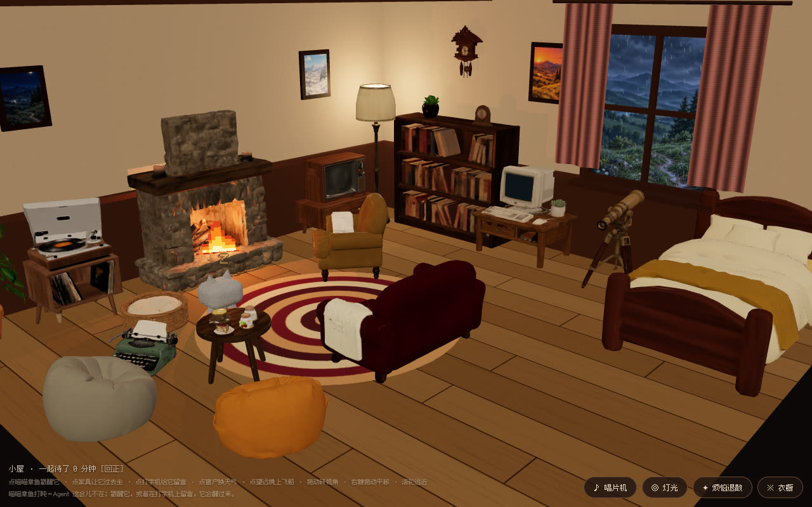

# 陪伴小屋 · Companion Cottage

一间可以挂机的 3D 小木屋，里面住着一只喵喵章鱼。它是一个看得见的 Personal Agent：会在屋里溜达、坐沙发、钻猫窝、爬上床；你戳它，它会醒；你在打字机上给它留言，它会回信。

**在线试玩：** https://circe.circeworks.com/cottage/
**参赛：** 群核科技 Aholo 全球 3D AI 黑客松（2026）



## Aholo Lux3D 在这里做了什么

屋里的 **17 件家具全部用 Aholo Lux3D 文生 3D 生成**：壁炉、沙发、床、书架、懒人沙发、猫窝、望远镜、打字机、布谷鸟钟、唱片机、电视、电脑、台灯、盆栽……

```
提示词（prompts/*.json）
  → Lux3D text-to-3d（G1-Turbo · 20000 面 · PBR · GLB）   tools/lux3d.py
  → 瘦身：贴图缩到 512、按需减面                           tools/shrink_glb.sh（gltf-transform）
  → 压缩：贴图转 WebP、网格 meshopt 压缩                    gltf-transform webp / meshopt
  → three.js 场景：摆位、碰撞、座位点、交互               game.js
```

提示词统一写成 “cozy stylized cartoon game asset, soft rounded shapes, warm hand-painted colors… single object, no floor, no background”，保证 17 件家具风格一致、可以直接摆进同一个场景。原始模型合计约 150 MB，瘦身、压缩后约 4 MB。网页版先下壁炉、沙发等 6 件核心家具（约 1 MB）就开门，其余家具进屋后下完一件摆一件。

## 玩法

- 点喵喵章鱼：戳醒它、摸头
- 点家具（沙发、床、猫窝、懒人沙发）：它走过去坐下
- 点打字机：给它留言，它用打字机回信（在线版是本地 ELIZA 规则回复）
- 窗外的风景随真实时间换清晨、白天、傍晚、夜里，天气每天随机，点窗户可以换
- 点望远镜：上飞船二号房，失重漂浮
- 右下角：唱片机、灯光开关、「烦恼退散」（写下烦恼，被像素激光炸掉）、衣橱换装

## 跑起来

```
python3 build.py      # → dist/cottage.html（单文件，离线双击即开）
```

重新生成模型：`AHOLO_KEY=… python3 tools/lux3d.py text prompts/sofa.json out/sofa`，然后 `tools/shrink_glb.sh out/sofa/out0.glb models/props/sofa.glb`。

## 目录

| 路径 | 内容 |
|---|---|
| `game.js` | 整个场景：屋子、灯光、角色（代码搭的身体＋毛发壳层＋像素眼＋骨骼）、家具座位、交互 |
| `models/props/` | 17 件 Lux3D 生成的家具（已瘦身） |
| `prompts/` | 生成家具用的提示词 |
| `tools/` | Lux3D 客户端、模型瘦身脚本 |
| `pics/` | 墙上的画、窗外 12 张风景（AI 生成） |
| `vendor/three/` | three.js 0.160（MIT） |
| `fonts/` | Fusion Pixel 像素字体（SIL OFL 1.1，见 `fonts/fusion-pixel-OFL.txt`） |
| `audio/` | 飞船房 BGM |

## 许可

代码以 MIT 许可发布。three.js 为 MIT，Fusion Pixel 字体为 SIL OFL 1.1。家具模型由 Aholo Lux3D 生成，窗外风景与墙上的画由 AI 生成。
